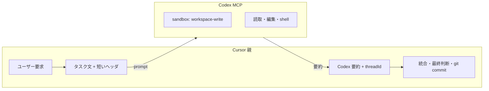

# Codex 委譲（サブエージェント・別 LLM）

Cursor 親と **Codex MCP サブエージェント**の役割分担。

## 目的

1. **別 LLM・別スレッド** — 調査・仕様・実装・横断確認を Codex に任せ、Cursor のコンテキストを節約する。
2. **自律調査** — 親が載せ忘れたファイルも、**リポジトリ内なら Codex が自分で読める**（パケット必須ではない）。
3. **パス境界** — **cwd（リポジトリ）内の読書き**（`sandbox_mode = workspace-write`）。リポジトリ外は原則不可（将来 `workspace_roots` で明示）。

## モデル



| 層 | 保持するもの |
|----|--------------|
| **Cursor** | ユーザー意図、Codex **要約**、レビュー指摘一覧、継続作業の `threadId` |
| **Codex** | スレッド内の調査・編集・会話全文 |

親は Codex 全文、diff 全文、`verify.sh` 全ログを履歴に貼らない。実装・設計の追い込みは `codex-reply` + 同じ `threadId`、独立レビューは実装履歴を持たない新規 `codex` を使う。

## thread ライフサイクルと速さ

実装の継続性とレビューの独立性は別の目的である。次の境界を固定する。

| 作業 | thread | 理由 |
|------|--------|------|
| 設計・実装・指摘修正の続き | `codex-reply` + 同一 `threadId` | 調査履歴を再利用し Cursor のコンテキストと冷スタートを節約 |
| 独立レビュー / 再レビュー | **毎回新規 `codex`** | 実装時の判断・記憶・自己正当化から独立した別視点を得る |
| spike の同一調査 | `codex-reply` 可 | 限定した調査文脈を再利用 |

レビューは `CODEX_TASK=review` + `CODEX_USE_PACKET=1` を既定とし、Codex は指摘だけ返して編集しない。修正は Cursor 親または実装用 thread が行う。再レビューは前回指摘と修正 diff を新規 review thread に渡し、重大・中が 0 件なら Pass とする。軽微だけなら再レビューせず、親の品質ゲートで完了する。

実測上、体感遅さの主因と対策:

| 要因 | 対策 |
|------|------|
| 実装の続きで毎回新しい `codex` | `codex-reply` + 同一 `threadId` |
| 実装 thread をレビューへ流用 | 新規 review thread + packet。独立性と小さい context を優先 |
| 長大 thread でレビュー・修正を反復 | review は指摘のみ。修正を別作業へ切り出し、再レビューも新規 thread |
| `model_reasoning_effort: medium` 固定 | **review / spike は `low`**。実装・設計は `medium` |
| 完了時の `./scripts/verify.sh` | **実装完了時のみ**。設計書・レビュー・調査だけのターンでは求めない |
| 探索ターン過多 | タスク文に **読むべきパスを具体的に**書く |

推奨 config の確認:

```bash
CODEX_TASK=review CODEX_PRINT_CONFIG_HINT=1 ./scripts/codex-mcp-prompt.sh
```

環境側の誤診・`arg0` ENOENT は [`docs/manual/codex-linux-sandbox.md`](./manual/codex-linux-sandbox.md)。

## 権限

リポジトリ直下の [`.codex/config.toml`](../.codex/config.toml):

| 設定元 | 意味 |
|--------|------|
| `scripts/codex-mcp-wrapper.sh` | `sandbox_mode = "workspace-write"` と network off を強制 |
| `[sandbox_workspace_write] network_access = false` | プロジェクト設定でもシェルからのネットワークを無効化 |

CLI / MCP wrapper は `umask 077` を設定し、新しく作成するセッション履歴をユーザー本人だけが読める権限にする。

**将来**: Codex の `[permissions.aish-subagent]`（beta）例は [codex.config.example.toml](./codex.config.example.toml)。

MCP の `codex` 呼び出しでは `sandbox: workspace-write` を渡す。`danger-full-access` は使わない。

## MCP 呼び出し（親エージェント）

### 1. prompt を組み立てる（既定）

```bash
{
  ./scripts/codex-mcp-prompt.sh
  echo
  cat <<'EOF'
  （ここにタスク。例: aibe の agent_turn と hexagonal チェックを横断確認し、
  問題があれば修正して cargo test まで通して。）
  EOF
} 
# → 連結した全文を MCP codex の prompt に渡す
```

**やらないこと**: prompt に「`target/xxx.txt` を読め」だけ書く（ファイルパス参照だけにしない。タスク文を必ず含める）。

### 2. パケット

```bash
CODEX_USE_PACKET=1 CODEX_TASK=review ./scripts/codex-mcp-prompt.sh
```

`codex-context.sh` の diff・抜粋を同梱する。**review では既定で有効**、その他のタスクでは親がコンテキストを絞りたいときだけ使う。親は packet の diff を会話へ複製せず、短いタスク文だけ追加する。レビュー深度は [codex-review.md](./codex-review.md)。

### 3. 追加許可パス（そのターンだけ）

```bash
CODEX_EXTRA_ROOTS="$HOME/.config/aibe,$HOME/.local/share/aish" ./scripts/codex-mcp-prompt.sh
```

恒久に許可するなら `.codex/config.toml` の `workspace_roots` に追記。

### 4. MCP 引数

| 引数 | 値 |
|------|-----|
| `cwd` | リポジトリルート |
| `approval-policy` | `never` |
| `config` | 通常: `{"approval_policy":"never","model_reasoning_effort":"medium"}`、**review / spike: `low`** |
| `sandbox` | `workspace-write` |
| `developer-instructions` | `.cursor/rules/50-codex-subagent.mdc` 参照（docs のみのときは verify 義務を外す） |

### 5. 続き

- 設計・実装・修正の同一作業は `codex-reply` + `threadId`
- **review / 再レビューは必ず新規 `codex`**。実装・前回レビューの `threadId` を継がない
- 再レビューには前回指摘の短い要約 + `CODEX_REVIEW_MODE=fast` の修正 diff packet を渡す

## タスク種別（`CODEX_TASK`）

| 値 | 用途 | effort | verify.sh |
|----|------|--------|-----------|
| `subagent` | 既定。調査・実装・修正・検証など自由記述 | medium | 実装完了時のみ |
| `spec` | **設計書**を `docs/spec/` に出力。実装指示は `docs/tasks/`。**0056 以降**は [`_feature-spec-template.md`](spec/_feature-spec-template.md) の必須節を含める | medium | 不要 |
| `review` | 独立した変更監査（新規 thread、packet 既定、指摘のみ） | **low** | 不要 |
| `audit` | 境界・セキュリティ横断 | medium | 不要（指摘対応の実装完了時は必要） |
| `spike` | 設計比較・調査のみ | **low** | 不要 |

`CODEX_TASK` は `codex-mcp-prompt.sh` の Role 行に反映される。推論強度は MCP の `config` 引数で明示し、`CODEX_PRINT_CONFIG_HINT=1` で推奨 JSON を確認できる。実際の作業内容は **prompt 本文**で伝える。プロジェクトローカルの `[profiles.*]` は Codex 0.134 以降無視されるため使わない。

## Codex に任せてよいこと

- リポジトリ内の読取・編集・`cargo fmt` / `clippy` / `test` / `./scripts/check-architecture.sh`
- 実装中の `./scripts/verify-targeted.sh` と、完了直前の `./scripts/verify.sh`
- 設計書（`docs/spec/`）・実装指示書（`docs/tasks/`）
- 横断調査・指摘・修正案の実装（ただし `review` は指摘のみで編集禁止）

## 親（Cursor）が担うこと

- ユーザー意図の最終判断
- Codex 要約・レビュー指摘一覧の保持と統合（Codex 全文、diff 全文、cargo test 全ログは保持しない）
- packet はスクリプト側で生成し、親は短い目的・正本・レビュー観点だけを加える
- **`git commit` / `push` はユーザー明示時のみ**（Codex に任せない運用を推奨）
- feature ブランチ運用時の **commit 整理（soft reset → 意味単位で commit し直し）** は Codex 完了後に親が行う（`.cursor/rules/05-git-workflow.mdc`）
- MCP 障害時のフォールバック
- **完了監査**: Codex の「完了」報告後、設計書の受け入れ条件と [`scripts/spec-acceptance.toml`](../scripts/spec-acceptance.toml) を照合。`pending` が残る spec では `docs/done/` 移動・index の「実装済み」更新をしない（`.cursor/rules/45-spec-completion-gates.mdc`）

## 完了ゲート（実装タスク共通）

検証は二段階で行う。実装中は変更対象だけを `./scripts/verify-targeted.sh` で確認し、完了報告の直前に `./scripts/verify.sh` を実行する。全体ゲート失敗後は失敗した検査だけで修正を回し、最後に全体ゲートを再実行する。targeted検証だけでは完了扱いにしない。

| 段階 | 条件 |
|------|------|
| 着手 | 実装指示書が `docs/tasks/` にある |
| Phase 完了 | 当該 Phase の `spec-acceptance.toml` エントリが `pending = false` かつテスト緑 |
| 全体完了 | 全 Phase の `pending = false` + `./scripts/verify.sh` + 実装指示書を `docs/done/` へ |

`verify.sh` だけ緑でも、受け入れレジストリに `pending = true` が残っていれば **仕様未完了** とする。

## Feature Scope（0056 以降）

新規 spec では次を守る。

**仕様作成時** — 設計書に Core outcome / Minimum vertical slice / Fault model / Non-goals / Complexity inventory / Complexity Gate / Complexity budget / Split triggers / Deferred specs を含め、`scripts/feature-scope.toml` に entry を追加する。

**実装時** — 新しい複雑性要因を発見しても自動実装しない。`STOP-THE-LINE` 形式で報告する（詳細: [feature-development-policy.md](./feature-development-policy.md)）。

**レビュー時** — 指摘に `BLOCKER_ORIGINAL_AC` / `REGRESSION` / `SAFETY_WITHIN_FAULT_MODEL` / `NEW_REQUIREMENT` / `HARDENING` / `OUT_OF_FAULT_MODEL` を付ける。`NEW_REQUIREMENT` / `HARDENING` / `OUT_OF_FAULT_MODEL` は別 spec 候補として分離する。

## Linux: `bwrap: loopback: Operation not permitted`

Ubuntu 24.04 などで AppArmor が unprivileged user namespace を制限していると、Codex の **bwrap** サンドボックスが失敗し、MCP からの `cat` / `rg` も同じエラーになる。

**CLI / Cursor MCP**

```bash
./scripts/codex-cli.sh …
```

- CLI / MCP wrapper はbwrapを優先し、利用不能な間だけLandlockへフォールバック
- [`.cursor/mcp.json`](../.cursor/mcp.json) → `scripts/codex-mcp-wrapper.sh`（認証は `~/.codex`、`workspace-write`）
- 事前に `codex login`（ChatGPT または API キー）
- **設定変更後は MCP 再接続が必須**

診断: `./scripts/codex-fix-linux-sandbox.sh`（**ホスト端末で実行**。Cursor エージェント sandbox 内だと所有権・bwrap・WebSocket が誤検知になりやすい。詳細は [`docs/manual/codex-linux-sandbox.md`](./manual/codex-linux-sandbox.md)）

bwrap用AppArmor profileを有効化:

```bash
sudo apt-get install -y apparmor-profiles apparmor-utils bubblewrap
sudo install -m 0644 /usr/share/apparmor/extra-profiles/bwrap-userns-restrict /etc/apparmor.d/bwrap-userns-restrict
sudo apparmor_parser -r /etc/apparmor.d/bwrap-userns-restrict
```

`kernel.apparmor_restrict_unprivileged_userns=0` によるシステム全体の制限解除は行わない。

## MCP がそれでも動かないとき

1. Cursor の **Codex MCP** にシェル実行権限（Settings → MCP）
2. `Unable to spawn .../codex-linux-sandbox` → MCP Restart / Cursor 再起動。`~/.codex/tmp/arg0` を稼働中に消さない
3. 手元で `codex` CLI（MCP 外）
4. 親が代替し **Codex 未実施**を明記

## 関連

- ルール: `.cursor/rules/50-codex-subagent.mdc`
- オプションの厚いパケット: [codex-review.md](./codex-review.md)
- 入口: `AGENTS.md`
